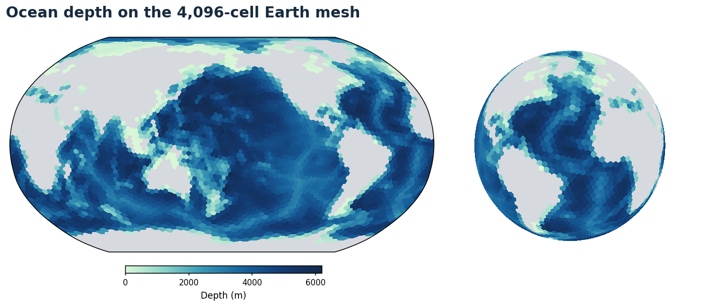

# Plot fields on the native VFS mesh

`vfs_plotting.plot_field(field, mesh)` draws each scalar on its native spherical
mesh element. Choose a Robinson map or a rotatable 3D globe. The colors come
directly from the supplied values, with one color shared by both pieces of a
cell that crosses the map boundary. The plotting code performs no regridding.



## From an Earth campaign snapshot

From the checkout, install the plotting dependencies in your VFS environment
once with `python -m pip install -e '.[plotting]'`. With Matplotlib and Cartopy
already available, you can run the command directly from the checkout.

```bash
run=runs/earth-shelf-40m-day1
python -m vfs_plotting "$run/snapshots/state_00086400.nc" ocean_temperature \
    --isel ocean_level=0 --wet-only --central-longitude 180 \
    --title 'Sea surface temperature at day 1' --output "$run/sst-day1.png"
```

Add `--projection 3d` for the globe. `--central-longitude` selects the longitude
facing the viewer in 3D and the center of the map in Robinson. `--elevation`
sets the latitude of the 3D camera. Omit `--output` to use your interactive
Matplotlib backend. PNG, SVG and PDF output work on a headless compute node.

Repeat `--isel DIM=INDEX` to select layers, times, species or ice categories.
Singleton dimensions such as the time in an instantaneous snapshot are selected
automatically. `--wet-only` masks land and, for an ocean-level field, any cell
whose active layers end above the selected index. `--cmap`, `--vmin` and
`--vmax` let you use a common scale across plots.

## From Python

```python
import xarray as xr
from vfs_plotting import plot_field

with xr.open_dataset("snapshots/state_00086400.nc") as ds:
    sst = ds.ocean_temperature.isel(time=0, ocean_level=0).where(ds.land_mask == 0)
    artist = plot_field(sst, ds, central_longitude=180, title="Sea surface temperature")
    artist.figure.savefig("sst.png", dpi=180)

    wind = ds.air_normal_wind.isel(time=0, air_level=-1)
    plot_field(wind, ds, projection="3d", central_longitude=-45, cmap="RdBu_r",
               vmin=-40, vmax=40, title="Near-surface edge-normal wind")
```

The second argument supplies the geometry. Pass an open campaign Dataset for a
snapshot or restart, or pass the model's live `VoronoiMesh` alongside a
one-dimensional VFS `Field`, tensor or NumPy array. A field saved separately
from its mesh can use `--mesh /path/to/mesh.nc` or, for cell data, `--mesh
/path/to/generators.npy`. Two NetCDF inputs with recorded mesh hashes must
agree. Native arrays use the mesh's ordering. Labeled xarray cell and edge
slices retain their IDs. Masked and nonfinite samples appear gray.

| Sample location | Area carrying its color |
|---|---|
| Cell | Native Voronoi polygon |
| Edge | Two triangles joining the shared edge to the centers of its adjacent cells. A signed normal wind keeps its sign. |
| Vertex | Dual Delaunay triangle formed by the three incident cell centers |
| Compact land column | Voronoi polygon identified by `land_cell_index` |

For generator-only geography and older snapshots, the utility reconstructs the
Voronoi outlines once per plot from the saved generators. Historical snapshots
with `cells_on_edge` also retain their recorded edge order. Vertex fields
require a mesh with stored vertex ordering.

Supply `ax=` to draw into an existing Cartopy Robinson or Matplotlib 3D axis
and `colorbar=False` to share a colorbar between panels. The return value is a
Matplotlib collection suitable for `figure.colorbar(artist, ...)`.
