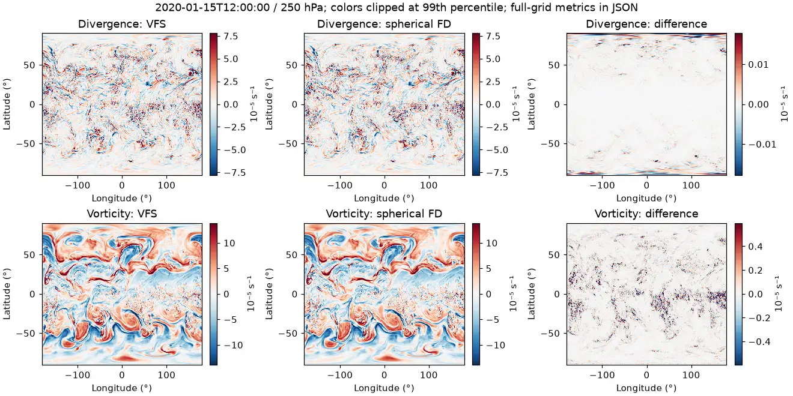
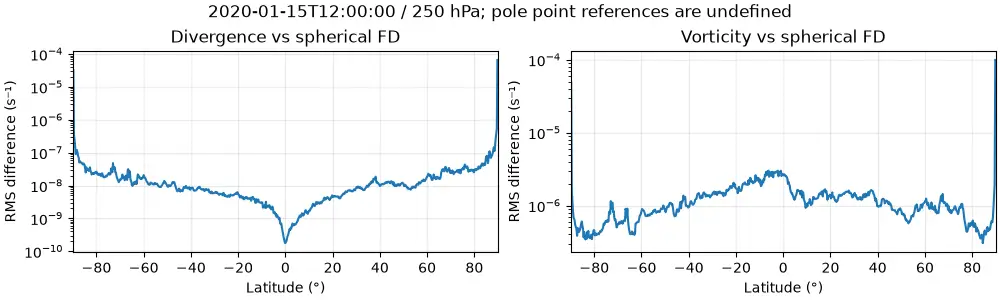

# ERA5 diagnostic measurements

Eight cases use four 2020 snapshots (January, April, July and October 15 at
12 UTC), each at 250 and 500 hPa. All are global 721×1440 WB2 ERA5 fields.
The supplied coordinates and ordering are retained. Calculations use CPU
float64 and radius 6,367,500 m. Source winds are archived float32 samples.

The [manifest and results](../../verification/equiangular/weatherbench2/metrics.json)
record the exact source URI, coordinates, input-field hashes, installed operator
and driver hashes, and environment. Each case file includes every comparison,
regional budget and coarse-scale measurement. Plots are measurements, not
accuracy gates. The [reference provenance](../../verification/equiangular/weatherbench2/reference-provenance.json)
pins the inspected upstream source; it does not assert that commit generated the
archived derived fields.

## Full spherical finite-difference comparison

This table excludes |latitude| >= 85 degrees to avoid mixing finite-volume cap
averages with singular point derivatives. Polar-band metrics remain in the
JSON and latitude plots; no polar data are removed from VFS's operators/budgets.

| Time (UTC) | hPa | Divergence RMS (s⁻¹) | Vorticity RMS (s⁻¹) | Vorticity correlation |
| --- | ---: | ---: | ---: | ---: |
| 2020-01-15T12:00:00 | 250 | 1.10963e-08 | 1.49948e-06 | 0.9995859 |
| 2020-01-15T12:00:00 | 500 | 1.25542e-08 | 1.78456e-06 | 0.9992174 |
| 2020-04-15T12:00:00 | 250 | 1.32059e-08 | 1.53012e-06 | 0.9996422 |
| 2020-04-15T12:00:00 | 500 | 1.63238e-08 | 1.77654e-06 | 0.9993154 |
| 2020-07-15T12:00:00 | 250 | 1.44005e-08 | 1.41827e-06 | 0.9996959 |
| 2020-07-15T12:00:00 | 500 | 1.58581e-08 | 1.75014e-06 | 0.9992023 |
| 2020-10-15T12:00:00 | 250 | 1.20493e-08 | 1.28979e-06 | 0.9997315 |
| 2020-10-15T12:00:00 | 500 | 1.38512e-08 | 1.64985e-06 | 0.9993740 |

Below 85 degrees, divergence RMS differences are 0.046–0.083% of the FD reference
RMS, and vorticity differences are 2.37–4.15%. Correlations alone conceal amplitude
and smoothing differences: the VFS cell curl includes dual-to-cell averaging.
The FD reference is an independent discretization, not exact atmospheric truth.

## Structural checks and WB2 reference interpretation

The maximum normalized regional divergence/curl budget residual over all cases
and regions is 4.75e−17 (rounded upward). Coordinate-order invariance has maximum
relative differences below 3.36e−16. Geopotential curl(grad) and the matched
integration-by-parts checks pass. These checks use the native finite-volume
faces/dual cells; they are distinct from pointwise comparison with the archive.

The archived WB2 fields agree with replay of the inspected simplified formulas
to RMS <= 3.64e−12 s⁻¹ below 85 degrees. They differ from VFS by about 10.8–15.1%
relative RMS for divergence and 7.50–8.57% for vorticity. The close replay supports
the curvature/seam explanation described in [the guide](README.md); agreement
with the archive is not used as an exact spherical correctness requirement.

## Coarse-scale sensitivity

All cases include 32×64 centered and 121×240 pole-sampled targets. On the January
250 hPa case, common-scale VFS-versus-FD vorticity RMS differences decrease from
1.50e−6 s⁻¹ at the source grid to 3.34e−7 at 121×240 and 3.90e−8 at 32×64.
This illustrates the effect of matching spatial support; it is not a convergence
study against an exact solution.

In contrast, differentiating averaged winds versus averaging the fine-grid
vorticity gives RMS differences 1.31e−5 and 1.71e−5 s⁻¹ on those targets. For
many applications, the resolution/operation-order choice therefore matters more
than the difference between the two fine-grid derivative implementations.
Scalar overlap averages are area-conservative; vector tangent projection and
finite differences are not assumed to commute with that averaging.

## Reproduction and limits

Run the default command in [README.md](README.md). The installed-wheel portable
suite outside the checkout passed **883 tests, one CUDA skip**. Seven new offline
tests check the campaign's budgets, reference formulas, area overlaps, polar
vector basis, coordinate transformations and local-file path. No cloud request
or plotting dependency is required by those tests. Hosted CI copies the optional
validation directory so the same offline tests execute there.

[File manifest](../../verification/equiangular/weatherbench2/files.json) lists
included artifacts and the omitted April 250 hPa map (`case-03.webp`, 132,360
bytes), which exceeds the 128 KiB cap. Its numerical metrics and latitude profile
are retained; running the script regenerates the map. No ERA5 input arrays are
committed. All other generated per-file outputs fit the cap.

This is a small real-data campaign, not an all-season climatology, forecast
validation, stress/drag parameterization test, coastline treatment, GPU benchmark,
or a claim of uniformly second-order polar accuracy. Surface stress curl still
uses the same linear spatial operator, but no ERA5 stress field is measured here.
