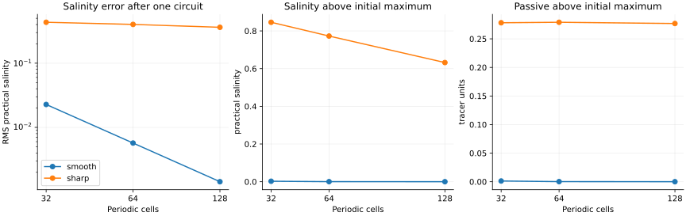
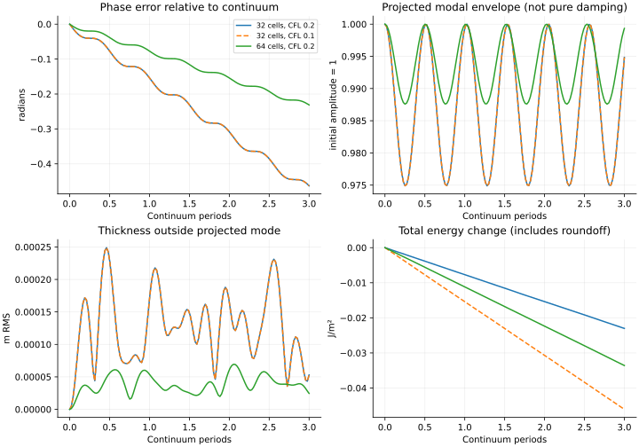
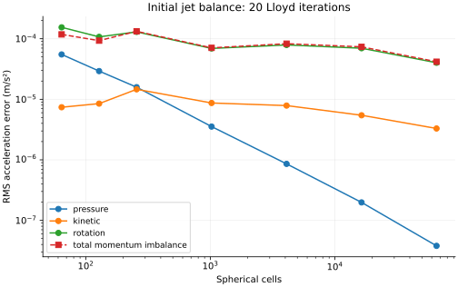

# Frozen ocean candidate qualification

Candidate: draft #36, commit `705720c79e38c2f07de39d45a33c9ede50707b87`.
This campaign measures its existing research implementation without changing
operators, limiters, calorics, timestepping, runtime defaults or tolerances.
It does not promote the candidate to the installed runtime or merge ALE #32.
JMD95 remains the density law; surface calorics remain the explicitly
GSW/TEOS-10-derived reference documented in [SEAWATER_CALORICS.md](SEAWATER_CALORICS.md).

## Questions and scope

1. Does a small internal wave retain its phase and amplitude over three periods,
   and how do mesh and timestep refinement affect those measurements?
2. How far does the rotating Williamson solid-body equilibrium drift over seven
   days? Does a stratified resting state remain at rest over flat/sloping bottom?
3. What accuracy and oscillations does the scalar transport produce on smooth
   profiles and sharp fronts, separately from momentum/heat feedback?

These are measurements, not subjective pass/fail accuracy gates. Positivity,
conservation, phase accuracy and local-extremum preservation are distinct.
All trajectories use CPU float64, one PyTorch thread and the existing SSPRK3
candidate. No diffusion, balancing correction, retuning or automatic retry was
added. Exactly fresh active salt remains unsupported. There is no GPU,
backpropagation, performance, baroclinic-growth, turbulent-mixing or coupled
atmosphere qualification here.

## Case matrix

| Family | Mesh | Duration | Step policy | Reference |
| --- | --- | --- | --- | --- |
| Nonlinear two-layer internal wave | 32, 64 spherical cells | 3 periods | external CFL 0.2 | independent continuum vertical-mode calculation |
| Wave temporal comparison | 32 cells | 3 periods | external CFL 0.1 | same initial state and duration |
| Nonlinear rotating jet | 64, 128, 256 cells | 7 days | 600 s | Williamson case 2 continuum equilibrium |
| Jet temporal comparison | 64 cells | 7 days | 300 s | same initial state and duration |
| Nonlinear stratified rest | 64 cells; flat and sloping bottom | 1 day | 600 s | stationary, flat upper interfaces |
| Isolated scalar transport | 32, 64, 128 periodic cells | 1 circuit | CFL 0.2 | translated smooth sine / sharp step |

Wave radius is 100 km, layers 500/2500 m, initial temperature 17/4 degrees
IPTS-68 and practical salinity 34/35.5. The 0.1 m displacement is a continuum
Y10 harmonic times the slow vertical eigenvector. The continuum period is
117898.884829 s (about 32.75 hours); three periods are about 4.09 days.
There is no planetary rotation in this wave case. The fastest continuum
external mode sets the step. Steps are rounded up and dt reduced to land on
the exact requested duration. Mesh Lloyd iterations: wave 10, balance 20.

The jet uses the existing Williamson constants and reference composition
(theta=10, SP=35), so it probes the inherited rotating/kinetic operators rather
than baroclinic pressure accuracy. Its continuum equilibrium is sampled on the
mesh, not adjusted to be an exact discrete equilibrium. Stratified rest has
three layers: theta=[17,10,4], SP=[34,35,35.5], thicknesses
[500,1000,bottom-1500] m, bottom=3000 m or 3000+200*x m. The sloping-bottom case
has flat upper interfaces and no horizontal composition gradients within layers.

Scalar transport prescribes unit carrier speed and thickness on a unit ring.
Smooth q=0.5+0.4 sin(2 pi x); sharp q is a half-domain indicator. SP=34+2q,
theta=10+2q; entropy is computed from the reference potential. Initial/reference
cell averages use 12-point Gauss integration. Initial and final sharp jumps
align with cell boundaries. The Gibbs active traces and bounded passive traces
are the candidate's, but **momentum and heating feedback are disabled** in this
isolated transport experiment. This is not a full active-front trajectory.

## Interpretation of diagnostics

- Wave phase is atan2(-qdot/omega,q), unwrapped at approximately 48 samples per
  period. Frequency is the fitted phase slope divided by continuum omega.
  The envelope sqrt(q²+(qdot/omega)²)/0.1 is a **modal envelope**, not a unique
  measure of dissipation: continuum Y10 is not an exact discrete eigenmode.
  Off-mode thickness error and a separate linear mesh-Laplacian spectrum
  expose redistribution and geometric frequency bias. That spectrum is a
  diagnostic reference, not an exact oracle for nonlinear dynamics.
- Thickness/velocity errors use cell-area and edge-diamond weights respectively.
  Jet errors compare against the initial steady continuum solution. Initial
  pressure, kinetic and rotation term errors retain the existing independent
  Williamson diagnosis.
- Energy changes are J/m², using separately differenced dynamic and caloric
  contributions; there is no exact finite-step energy claim. Tiny changes near
  rest are subject to floating-point cancellation. Entropy changes are J/K/m²;
  negative roundoff accumulation is reported rather than clipped to zero.
- Transport L1/RMS errors, extrema, total variation and inventory changes are
  recorded separately. Global admissibility bounds do not imply preservation
  of the initial 34–36 salinity interval or the passive maximum of one.

## Reproduction

Build/install the candidate wheel and run outside the checkout with copies of
`tools/`, as in installed-wheel CI. `gsw==3.6.23` is an independent research
reference dependency, never a VFS runtime dependency. Use Python 3.12,
`torch==2.15.0+cpu`, NumPy 2.3.5. For example:

```sh
python -I tools/qualify_ocean_entropy.py wave --cells 32 --cfl .2 --periods 3 --output results/wave-32.json
python -I tools/qualify_ocean_entropy.py wave --cells 64 --cfl .2 --periods 3 --output results/wave-64.json
python -I tools/qualify_ocean_entropy.py wave --cells 32 --cfl .1 --periods 3 --output results/wave-32-halfdt.json
python -I tools/qualify_ocean_entropy.py balance --cells 64 --profile jet --days 7 --dt 600 --output results/jet-64.json
python -I tools/qualify_ocean_entropy.py balance --cells 128 --profile jet --days 7 --dt 600 --output results/jet-128.json
python -I tools/qualify_ocean_entropy.py balance --cells 256 --profile jet --days 7 --dt 600 --output results/jet-256.json
python -I tools/qualify_ocean_entropy.py balance --cells 64 --profile jet --days 7 --dt 300 --output results/jet-64-halfdt.json
python -I tools/qualify_ocean_entropy.py balance --cells 64 --profile flat --days 1 --dt 600 --output results/rest-flat.json
python -I tools/qualify_ocean_entropy.py balance --cells 64 --profile topography --days 1 --dt 600 --output results/rest-topography.json
```

For both `smooth` and `sharp`, repeat the following at 32, 64 and 128 cells:

```sh
python -I tools/qualify_ocean_entropy.py transport --cells 32 --profile smooth --circuits 1 --cfl .2 --output results/transport-smooth-32.json
python -I tools/analyze_ocean_qualification.py --directory results --output summary.json
```

Each report includes source hashes, step counts and completion/failure status.
Failures retain partial measurements and raise an exception. CI exercises tiny
runs and instrumentation tests, not the full-duration campaign. Results contain
scalar samples only; no field arrays, binaries or large logs are uploaded.

## Completed balanced-flow and transport measurements

| Jet cells | dt (s) | Seven-day velocity RMS error (m/s) | Thickness RMS error (m) | Energy change (J/m²) |
| --- | --- | --- | --- | --- |
| 64 | 600 | 5.310120 | 51.953389 | -3909.897918 |
| 128 | 600 | 2.738506 | 31.100813 | -4114.358569 |
| 256 | 600 | 1.869377 | 20.070108 | -25260.294930 |
| 64 | 300 | 5.310173 | 51.954446 | -489.615767 |

Initial velocity RMS is about 22.3 m/s, so the seven-day velocity errors are
23.8%, 12.3% and 8.38% of that scale at 64/128/256 cells. Initial kinetic energy
is about 1.32e9 J/m². At 64 cells and dt=600 s, energy loss is only about
2.96e-6 of initial kinetic energy while the velocity error is 23.8%. Energy
closure and balanced-flow accuracy are plainly different requirements.

Halving dt changes the 64-cell endpoint velocity-error norm by only 0.0000533
m/s and thickness-error norm by 0.00106 m; these are differences of norms,
not norms of trajectory differences (full fields are not archived). Energy
loss falls by a factor of 7.99, consistent with the tested third-order temporal
behavior. The substantial balanced-flow drift remains almost unchanged. This
supports a spatial-operator explanation for that drift, rather than a timestep
explanation. It is not proof of a unique cause.

| Cells | Initial pressure error (m/s² RMS) | Kinetic error | Rotation error |
| --- | --- | --- | --- |
| 64 | 5.50071e-05 | 7.38762e-06 | 0.000154192 |
| 128 | 2.92146e-05 | 8.47959e-06 | 0.000107345 |
| 256 | 1.58395e-05 | 1.46113e-05 | 0.000129746 |

Pressure error improves, while kinetic error increases and rotation error is
nonmonotone. The final solution-error norm improves with mesh refinement, but
that does **not** establish consistency of every constituent operator. The
existing reconstruction/rotation investigation remains relevant.

One-day stratified rest has velocity RMS 3.68e-14 m/s over flat bottom and
5.28e-14 m/s over sloping bottom. Thickness RMS changes are 8.61e-14 and
1.11e-13 m respectively. Total energy differences are +1.32e-7 and -2.31e-7
J/m²; these near-rest differences are at a cancellation-sensitive scale.

| Cells | Smooth SP RMS error | Smooth passive RMS error | Sharp SP range | Sharp passive maximum |
| --- | --- | --- | --- | --- |
| 32 | 0.02275458 | 0.01137786 | 33.16310–36.84594 | 1.278130 |
| 64 | 0.005704194 | 0.00285224 | 33.23520–36.77285 | 1.278983 |
| 128 | 0.001427004 | 0.0007135378 | 33.37405–36.63221 | 1.276802 |

Smooth RMS errors decrease at approximately second order in 1D mesh spacing
at fixed CFL. Sharp-front SP L1 errors are 0.3517, 0.3206 and 0.2633; RMS errors
are 0.4336, 0.4015 and 0.3623. Salinity total variation grows from its initial
4 to 12.38, 19.07 and 25.49. Thus smaller integrated error coexists with more
oscillation. Passive nonnegativity holds in these runs, but its maximum rises
above one by about 28%. The initial SP interval [34,36] is not preserved.
Neither the local maximum principle nor TVD is satisfied by these examples.
Inventory residuals remain near floating-point accumulation scale; the JSON
reports retain them individually. Smooth and sharp outcomes must not be
collapsed into a single statement that transport is "accurate" or "bounded."



## Three-period nonlinear wave measurements

| Cells | External CFL | Steps | Fitted frequency / continuum | Final phase error (rad) | Modal envelope range | Energy change (J/m²) |
| --- | --- | --- | --- | --- | --- | --- |
| 32 | 0.2 | 5007 | 0.975093725 | -0.463050539 | 0.974888–1.000000 | -0.02301187 |
| 64 | 0.2 | 7312 | 0.987685949 | -0.231298236 | 0.987581–1.000000 | -0.03358874 |
| 32 | 0.1 | 10013 | 0.975093955 | -0.463050538 | 0.974887–1.000000 | -0.04607703 |

All three full nonlinear runs reach three continuum periods without a stage
rejection. The 32/64-cell phase lags closely match the independent linear mesh
Laplacian prediction (-0.463051/-0.231298 radians). Projected amplitudes differ
from that linear reference by only 3.69e-09, 4.62e-09, 3.15e-09 m RMS for the three rows. This is strong evidence that the measured phase
bias and envelope modulation in this small-amplitude case are dominated by
spatial dispersion and the projection of a continuum mode onto discrete modes,
not by substantial dissipative decay. It is not a general nonlinear accuracy
or stability theorem. The modal envelope is not itself a damping coefficient.

Halving dt at 32 cells changes the final projected amplitude by 2.96e-09 m. It does not
remove the geometric phase lag. The finer spatial mesh roughly halves the
phase bias; two coarse meshes alone do not establish an asymptotic wave order.
The earlier short-wave 64/256-cell evidence remains in #36.

Total-energy differences must be interpreted carefully here. Initial linear
wave energy is only about 0.058 J/m², riding on a much larger thermodynamic
background. Normalized entropy-inventory changes are -3.05e-13, -4.46e-13, -6.12e-13 for the three rows; volume/salt residuals are likewise retained in the
JSONs. Total-energy drift grows approximately with step count instead of
showing temporal truncation-error improvement, while the projected dynamics
remain almost unchanged. This is consistent with accumulated inventory
roundoff on that background; it must not be presented as a measured physical
wave damping rate. A reference-subtracted perturbation-energy diagnostic is
still needed for a stronger energetic wave qualification. No energy residual
is hidden, corrected, or normalized away in the raw reports.



## Finer initial-balance refinement

The initial-tendency refinement extends to **1,024, 4,096, 16,384 and
65,536 cells**, holding the 20-iteration mesh-generation policy fixed. These
are initial measurements, not fine-grid seven-day trajectories. The finest
mean cell length sqrt(mean area) is 88.22 km globally. Evaluate both the
independent constant-density Williamson terms and the actual entropy/JMD95
candidate at reference composition, with dt=1 s for its transport ledger.
Also test the three-layer flat/sloping resting states on every fine mesh.
No operator changes or balancing adjustments are made.

| Cells | Mean cell length (km) | Pressure RMS error (m/s²) | Kinetic RMS error | Rotation RMS error | Candidate momentum imbalance RMS |
| --- | --- | --- | --- | --- | --- |
| 1,024 | 705.77 | 3.54215e-06 | 8.68607e-06 | 6.91833e-05 | 7.06853e-05 |
| 4,096 | 352.88 | 8.57655e-07 | 7.87228e-06 | 7.89264e-05 | 8.27752e-05 |
| 16,384 | 176.44 | 1.98141e-07 | 5.44544e-06 | 6.96676e-05 | 7.34492e-05 |
| 65,536 | 88.22 | 3.79735e-08 | 3.2946e-06 | 4.01519e-05 | 4.16963e-05 |

The finer sequence **changes the interpretation of the coarse results**:
kinetic error now decreases monotonically, rather than continuing the increase
seen at 64–256 cells. Over successive halvings of nominal mesh spacing, its
observed RMS orders are 0.14, 0.53, 0.72. Rotation orders are -0.19, 0.18, 0.80, versus pressure orders 2.05, 2.11, 2.38.
These are observed rates on this generated mesh family, not a proof of
asymptotic convergence or inconsistency. Pressure improves much faster;
rotation remains nonmonotone and dominates the fine-grid initial imbalance.
L1 and maximum norms are retained in each JSON: at 65,536 cells, momentum
imbalance RMS is 4.17e-5 m/s² while its maximum is 3.77e-4 m/s², so spatial
concentration of error should also be investigated.

At 4,096 cells, increasing Lloyd iterations from 20 to 100 gives pressure,
kinetic and rotation RMS errors 2.07e-6, 4.42e-5 and 5.89e-5 m/s², respectively;
total candidate imbalance is 8.37e-5 m/s² versus 8.28e-5 with 20 iterations.
More relaxation is not automatically better for these operators. All these
meshes exhaust their requested iteration budgets; none meets the builder's
centroid convergence criteria. Final relative centroid offsets and histories
are preserved. This sensitivity motivates jointly examining reconstruction,
rotation and mesh quality, rather than attributing the result to cell count
alone. The 100-iteration result is retained even though some errors worsen.

The active candidate and constant-density momentum tendencies agree to below
2e-17 m/s² RMS throughout these fine tests. Thus this reference-composition
imbalance is inherited from the common dynamical operators, not introduced by
the Gibbs/entropy adaptation. The largest absolute normalized candidate energy-work residual in the fine
initial tests is 8.75e-15; the raw work diagnostics are retained, without
relabeling these as exact arithmetic identities. Fine stratified resting states have exactly zero
thickness tendency and maximum momentum RMS 4.20e-18 m/s² over sloping bottom
(7.84e-19 over flat bottom). Small roundoff accelerations increase as gradients
are divided by finer spacings; these are initial tendencies, not long runs.

```sh
python -I tools/probe_ocean_initial_balance.py --cells 1024 --output results/initial-1024.json
python -I tools/probe_ocean_initial_balance.py --cells 4096 --output results/initial-4096.json
python -I tools/probe_ocean_initial_balance.py --cells 16384 --output results/initial-16384.json
python -I tools/probe_ocean_initial_balance.py --cells 65536 --output results/initial-65536.json
python -I tools/probe_ocean_initial_balance.py --cells 4096 --lloyd-iters 100 --output results/initial-4096-lloyd100.json
```



## Consequences for the development track

1. Keep conservation/admissibility tests, but add the measured sharp-front
   extrema and total variation to every proposed transport comparison. A next
   numerical PR can derive local-bound constraints while preserving the
   Gibbs identity, composition-attached entropy correction, stage ledgers and
   continuous single-edge zero-velocity limit. Do not independently clip salt,
   temperature or entropy after the step to hide the oscillations.
2. Continue joint kinetic-reconstruction/rotation consistency work. Repeat
   constituent-term diagnosis and balanced trajectories; lower energy drift
   from a smaller dt does not resolve the spatial balance defect.
3. Use wave phase, modal redistribution and the linear geometry reference
   together when evaluating changes. Add reference-subtracted perturbation
   energy diagnostics so inventory roundoff on the thermodynamic background
   is not misidentified as loss of wave energy. Expand beyond this small two-layer mode
   before claiming general stratified-wave accuracy or instability growth.
4. Only then assess opt-in active runtime integration and composition with ALE
   #32, followed by baroclinic-growth, backward/gradient, GPU/performance and
   coupled exchange-budget qualification. Nothing here establishes those.

The stored wall times are execution provenance under concurrent workloads,
not a performance benchmark. No numerical corrections are bundled into this
measurement campaign. Full field arrays, wheels and logs are intentionally
omitted; each committed artifact must remain below 128 KiB.

## Regression validation and artifact policy

Installed-wheel portable pytest outside the checkout: **722 passed, one CUDA
skip**, including five new instrumentation/reference checks. All 164 legacy
ocean tensors are exactly equal. Corrected-Gibbs and dry atmospheric portable
comparisons pass. Historical exact fixture discrepancies remain separate;
portable success is not claimed as historical exact equality. CI includes
short executions of the new wave, rest, transport and initial-balance drivers.

All installed runtime files and the frozen research candidate are unchanged.
Only measurement tools/tests, compact evidence, CI smoke commands and reports
are added. Every uploaded file is below 128 KiB. The per-case reports, their
hash manifest and the derived summary are in [qualification/](qualification/).
Regenerate the SVG figures with:

```sh
python -I tools/plot_ocean_qualification.py --directory results --output figures
```
