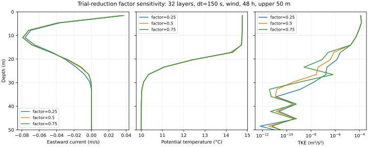

# Sustained column mixing and limiter sensitivity

**All 23 cases complete 48 hours with tight budgets.** The campaign establishes
sustained admissible evolution and exposes remaining timestep, vertical-resolution
and local limiter sensitivity. Physical entrainment accuracy and converged TKE
profiles are not established.

This campaign evaluates the energy-limited TKE closure from draft #58. The
production algorithm's default numerical behavior is unchanged: this branch
adds tensor diagnostics and exposes the existing 0.5 trial-reduction factor as
an explicit validated sensitivity parameter. It does not add TKE forcing,
change mixing lengths, retune coefficients, alter the EOS, or weaken guards.

## Experiments

All cases request 48 h with active scalar mixing. The primary matrix is
16/32/64 layers × 300/150 s × wind/cooling/rain-heating (18 cases). Five additional
32-layer wind cases examine dt=75 s, initial k=1e-6/1e-3 m²/s², and trial-reduction
factors 0.25/0.75. Primary k=1e-4 m²/s², L=2 m, factor=0.5. All other conditions
match [the original campaign](COLUMN_CAMPAIGN.md). The
[runner and analysis instructions](../../validation/ocean_column/README.md)
reproduce the matrix. A case that rejects retains its partial trajectory and
is excluded from equal-duration final-profile comparisons.

Seed sensitivity changes a physical initial energy reservoir: the 100 m,
1025 kg/m³ column starts with 0.1025, 10.25 or 102.5 J/m² of TKE for
k=1e-6, 1e-4 or 1e-3 m²/s², respectively. Differences between seed cases are
therefore not automatically numerical errors; they test how much initial-state
memory remains under the same forcing.

The layer counts apply to a 100 m test column (uniform layer thicknesses
6.25, 3.125 and 1.5625 m); they do not establish that 64 uniform layers are
adequate for a full-depth ocean.

The initial warm/fresh surface remains a centre-sampled profile. Cooling is a
surface forcing experiment, not an independently established convective benchmark.
The mixed-layer diagnostic uses a 0.2-degree surface temperature threshold and
must not be interpreted as density-based entrainment accuracy. There is no
horizontal dycore, ALE, bottom stress, atmosphere coupling or wave model here.

## What the limiter diagnostics mean

Pair counts include the even-half/odd-full/even-half sweeps. A limited pair has
accepted exchange coefficient below the original implicit-pair proposal. The
reported salt/enthalpy acceptance ratios sum absolute accepted transfers and
divide by the corresponding proposed transfers at the same actual stage.
These quantify suppression along the limited trajectory; they do not estimate
a separate unlimited run. Counts include active pairs with negligible scalar
contrast, so flux-weighted ratios are more useful for mixing strength.
Potential-enthalpy transport is not energy spent against buoyancy: the latter
is the measured pair Hamiltonian work. The acceptance ratio is neither a
thermodynamic mixing efficiency nor an energy-conservation residual.

Temperature/salinity comparisons use absolute thickness-weighted RMS differences.
Velocity errors use both components and the finer/reference norm. Fine fields
are conservatively averaged onto the coarse layer intervals; rain expansion is
included. Refinement changes the centre-sampled initial profile as well as the
numerics, so spatial differences do not establish formal convergence order.

## Results

All **23/23** cases reach 48 h without physical guard rejection. Across all
cases, the maximum absolute energy-minus-external-input residual is
**1.383e-9 J/kg of initial column mass**. Maximum freshwater mass residual is
3.28e-11 kg/m²; maximum relative salt and passive inventory changes are
2.60e-16 and 7.10e-16. No guard, fixture or tolerance was relaxed.

The independent wind/cooling depth-integrated transport reference has relative
errors approximately 3.75e-5, 9.38e-6 and 2.34e-6 at dt=300, 150 and 75 s.
This verifies the integral wind/rotation response, not the vertical profile.

The limiter acts on **every timestep** of every primary case. Between 33.2%
and 74.5% of active pair visits are limited; only 11.2–34.6% of proposed absolute
potential-enthalpy exchange is accepted. It is an important part of the effective
scalar mixing, not a rarely exercised guard.

### Primary-case budgets and limiter activity

| Forcing | Layers | dt (s) | Absolute energy residual (J/kg) | Limited pair visits (%) | Enthalpy accepted (%) | Temperature MLD (m) |
|---|---:|---:|---:|---:|---:|---:|
| wind | 16 | 300 | 5.544e-11 | 41.5 | 13.6 | 18.750 |
| wind | 16 | 150 | 7.280e-10 | 39.6 | 18.0 | 18.750 |
| wind | 32 | 300 | 1.054e-10 | 37.6 | 16.7 | 15.625 |
| wind | 32 | 150 | 4.999e-10 | 37.0 | 21.1 | 15.625 |
| wind | 64 | 300 | 5.094e-11 | 34.8 | 19.8 | 15.625 |
| wind | 64 | 150 | 5.404e-10 | 33.3 | 25.5 | 15.625 |
| cooling | 16 | 300 | 1.188e-10 | 40.0 | 11.2 | 18.750 |
| cooling | 16 | 150 | 7.509e-10 | 38.8 | 12.8 | 18.750 |
| cooling | 32 | 300 | 9.755e-11 | 37.9 | 18.1 | 15.625 |
| cooling | 32 | 150 | 4.531e-10 | 36.9 | 22.1 | 15.625 |
| cooling | 64 | 300 | 9.551e-11 | 35.0 | 23.1 | 15.625 |
| cooling | 64 | 150 | 3.888e-10 | 33.2 | 28.1 | 17.188 |
| rain_heating | 16 | 300 | 1.789e-10 | 74.5 | 14.0 | 12.521 |
| rain_heating | 16 | 150 | 1.609e-10 | 69.9 | 18.8 | 12.521 |
| rain_heating | 32 | 300 | 1.705e-10 | 68.0 | 24.0 | 15.646 |
| rain_heating | 32 | 150 | 3.263e-10 | 62.9 | 28.0 | 15.646 |
| rain_heating | 64 | 300 | 1.375e-10 | 64.0 | 29.2 | 15.646 |
| rain_heating | 64 | 150 | 3.665e-10 | 57.5 | 34.6 | 15.646 |

### Timestep refinement

These are differences between numerical runs, not errors against an analytic
or observed vertical profile. Differences compare dt=300 s with dt=150 s at
the same layer count. Norms use
the finer result as denominator. Temperature maxima show localized differences
that a full-column RMS can hide.

| Forcing | Layers | Velocity difference (%) | TKE difference (%) | Temperature RMS (°C) | Temperature max (°C) |
|---|---:|---:|---:|---:|---:|
| wind | 16 | 4.92 | 29.22 | 0.0217 | 0.0673 |
| wind | 32 | 6.74 | 27.57 | 0.0179 | 0.0822 |
| wind | 64 | 7.18 | 29.26 | 0.0280 | 0.1676 |
| cooling | 16 | 4.97 | 24.67 | 0.0051 | 0.0173 |
| cooling | 32 | 6.81 | 27.81 | 0.0173 | 0.0774 |
| cooling | 64 | 7.28 | 29.48 | 0.0266 | 0.1518 |
| rain_heating | 16 | 4.07 | 22.49 | 0.0318 | 0.1027 |
| rain_heating | 32 | 6.65 | 27.36 | 0.0160 | 0.0733 |
| rain_heating | 64 | 7.09 | 29.07 | 0.0267 | 0.1682 |

For the 32-layer wind case, another halving to **75 s** reduces the velocity
comparison from 6.74% to **3.44%** and the TKE comparison from 27.57% to **14.47%**.
Temperature RMS changes from 0.01794 to **0.01240°C** (maximum 0.04489°C for the
150→75 s comparison). Velocity/TKE differences roughly halve, consistent with
first-order temporal behavior over these steps. The frozen diffusivity,
backward-Euler momentum update and operator splitting remain first order.
No timestep-converged TKE profile is established.

### Vertical refinement at dt=150 s

| Forcing | Layer comparison | Velocity difference (%) | TKE difference (%) | Temperature RMS (°C) | Temperature max (°C) |
|---|---:|---:|---:|---:|---:|
| wind | 16→32 | 8.88 | 44.70 | 0.0547 | 0.1922 |
| wind | 32→64 | 2.88 | 20.32 | 0.0096 | 0.0385 |
| cooling | 16→32 | 9.37 | 43.53 | 0.0414 | 0.1420 |
| cooling | 32→64 | 2.85 | 20.00 | 0.0110 | 0.0483 |
| rain_heating | 16→32 | 9.06 | 46.31 | 0.0321 | 0.0992 |
| rain_heating | 32→64 | 2.94 | 20.69 | 0.0089 | 0.0327 |

Profiles approach one another with refinement: 32→64-layer velocity differences
are 2.85–2.94%, but TKE differences remain 20.0–20.7%. This is encouraging
refinement behavior, not a converged turbulence solution. The common timestep
is itself unresolved, and initial centre sampling changes with layer count.

### Seed and limiter-factor sensitivity

All comparisons below use 32 layers, dt=150 s and wind forcing. The reference
has initial k=1e-4 m²/s² and backtracking factor 0.5.

| Changed input | Velocity difference (%) | TKE difference (%) | Temperature RMS (°C) | Temperature max (°C) |
|---|---:|---:|---:|---:|
| Initial k=1e-06 | 0.0055 | 0.0035 | 0.00496 | 0.01743 |
| Initial k=0.001 | 0.0850 | 0.0153 | 0.01587 | 0.04822 |
| Trial factor=0.25 | 3.7601 | 1.0147 | 0.00799 | 0.03119 |
| Trial factor=0.75 | 1.0547 | 0.4071 | 0.01343 | 0.06250 |

The wind cases largely forget the positive turbulence seed in their velocity
and TKE profiles by 48 h. Scalar-profile changes remain measurable; initialization
adds physical TKE energy and can cause irreversible early mixing. Exactly-zero
startup was tested separately in #58 and is not fixed by these results.

**Bulk norms hide large local sensitivity in weakly turbulent layers.** After
inspecting the log-scale profiles, an additional fixed 15–30 m band diagnostic
was added. In the 32-layer wind case, factor 0.25 gives TKE values **3.44–51.57×**
the default at those layer centres; factor 0.75 gives **0.070–24.31×**. Default
TKE in this band ranges from 3.55e-10 to 7.51e-7 m²/s². These are local ratios,
not bulk energy differences. Exact depths, values and zero-reference handling
are retained in the comparison JSON. This post-inspection diagnostic is not a
predefined acceptance gate. It shows why small whole-column TKE norm differences
do not qualify local diffusivity or entrainment.

The full nine-panel resolution figure exceeds 128 KiB and is omitted. It can
be regenerated with `validation/ocean_column/plot_sustained.py`; numerical
profile records remain available in the compact evidence.

## Next numerical work

Keep the local energy guard. Before calibrating a mixed-layer response, reduce
and qualify the dependence on timestep and arbitrary trial reduction: compare
common physics substeps that keep shared edge momentum and cell TKE synchronized,
or a coupled positive TKE/scalar exchange update, and test a
more accurately located feasible exchange rather than accepting the first
heavily reduced trial. A nonlinear feasible search must still evaluate actual
Hamiltonian work; monotonicity cannot simply be assumed for every EOS state.
Track accepted scalar fluxes by interface as well as bulk norms, especially in
the weak-turbulence transition. Repeat the fixed matrix after numerical changes.

The proposed surface TKE input addresses startup and external energy supply.
It must not be used to conceal the local numerical sensitivity found here.
Independent entrainment/mixed-layer benchmarks and stability/length-scale
qualification remain necessary before physical accuracy claims.

[All compact case summaries](sustained-mixing/summary.json) ·
[Profile comparisons](sustained-mixing/comparisons.json) ·
[Omitted raw artifacts](sustained-mixing/omissions.json) ·
[Provenance](sustained-mixing/provenance.json).

## Regression and provenance

Installed-wheel CPU float64 suite outside checkout: 990 passed, one CUDA skip,
using the existing portable fixture mode. The separate final five-test column
harness run includes conservative-overlap analysis and exact checkpoint/restart
equivalence, including rejection of mismatched restart parameters.
Focused closure/harness tests: 32 passed. No fixtures or tolerances changed.
GPU behavior and derivatives at limiter switching points are unqualified.

The instrumented 16-layer/dt=300 s wind run exactly reproduces every final-profile
field of the prior 48-hour run from #58. See
[instrumentation equivalence](sustained-mixing/instrumentation-equivalence.json).
Default physical behavior is unchanged; nondefault reduction factors are
explicitly labelled sensitivity experiments, not revised defaults.

## Startup recommendation

See [the proposed surface TKE boundary flux](TKE_STARTUP_DESIGN.md). It would
supply an explicit external energy input to start wind-driven turbulence from
zero. It is not implemented here and does not resolve wind-free convective
onset or establish a calibrated mixing-length formulation.

## Execution interruptions

Seven final cases were preserved when the initial worker sessions disappeared.
Unfinished attempts without restart states were excluded from final-profile
comparisons and are recorded in
[the interruption manifest](sustained-mixing/interrupted-attempts.json).
The remaining cases were restarted with atomic hourly tensor checkpoints and
short execution segments; a test verifies exact restarted/uninterrupted output.
Execution interruption is distinct from physical guard rejection. Completed
cases are never shortened or substituted with an earlier transient.
