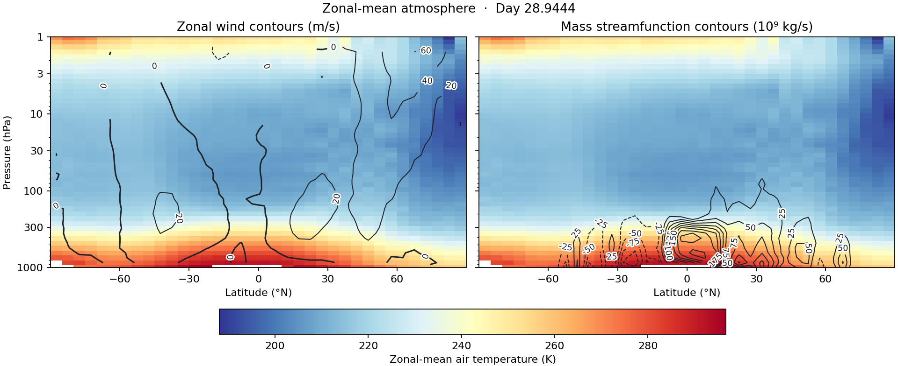

# VFS climate plots



## Notebook quick start

Install the checkout once with `python -m pip install -e '.[plotting]'` in the notebook environment. Compute a summary once, then experiment with the figures using the same xarray dataset.

```python
from pathlib import Path
from vfs_plotting import summarize, plot_section, plot_field, plot_zonal_mean

summary = summarize(Path("run/snapshots").glob("state_*.nc"), days=(15, 30))
# For an instantaneous view instead, use summarize("last_good_restart.nc").

ax = plot_section(summary, contours="zonal_wind")
ax = plot_section(summary, contours="streamfunction", levels=[-100, -50, -25, 25, 50, 100])
ax.set_ylim(1000, 100)  # focus on the troposphere
```

Temperature sets the colors in both sections. Pressure decreases upwards on a logarithmic axis. Use `pressure_scale="linear"` to give the lower atmosphere more space. Negative contours are dashed, positive contours solid. Wind is positive eastward. Positive streamfunction means a positive lid-to-pressure integral of northward mass transport. Its contour labels are in billions of kg/s. The default omits its zero contour to keep weak sign reversals aloft from dominating the figure. Pass `levels=` including zero to draw it.

```python
plot_field(summary.sst, summary, central_longitude=180, title="Sea surface temperature")
plot_zonal_mean(summary, "column_vapor")
```

To build your own layout, pass an existing Matplotlib axis with `ax=`. A standalone section or latitude profile returns the axis. The native map returns a Matplotlib collection. For paired figures use `plot_sections(summary)` or `plot_surface(summary)`, both of which return a figure. For raw native fields, `with open_state(path) as state:` opens one snapshot or restart using the snapshot field names. See the [native map guide](../docs/NATIVE_MESH_PLOTTING.md) for globe and projection options.

## Running plot list

| Plot | How to draw it | What to look for |
|---|---|---|
| Zonal-mean temperature with zonal-wind contours | `plot_section(summary, "zonal_wind")` | Jet strength, latitude and height relative to the meridional temperature gradient. |
| Zonal-mean temperature with mass-streamfunction contours | `plot_section(summary, "streamfunction")` | Overturning cell boundaries and the latitude of ascent relative to the warmest air. |
| Native mean surface maps | `plot_field(summary.sst, summary)`. Also available as `surface_air` and `column_vapor`. | The SST warm pool, seasonal land–ocean temperature contrasts and tropical moisture distribution. |
| Zonal-mean surface climate | `plot_zonal_mean(summary, "surface_air")`. Also accepts `"sst"` and `"column_vapor"`. | Hemispheric asymmetry, the equator-to-pole gradient and the latitude of peak moisture. |
| Precipitation map and zonal mean | When a cellwise precipitation flux in kg m⁻² s⁻¹ is saved, use `plot_field(summary.precipitation, summary)` or `plot_zonal_mean(summary, "precipitation")`. The 30-day pilot lacks this field. | Rain-belt latitude and width in mm/day. |
| Upper-tropospheric velocity potential | Proposed. Derive divergence on the native mesh at 200 hPa and solve the spherical Poisson equation with a zero global mean. | Large-scale divergent circulation over tropical heating regions. |
| Equatorial Pacific SST and subsurface temperature | Proposed. Add longitude–time SST and longitude–depth temperature sections across a selectable equatorial band. | Cold tongue development, warm-pool location and thermocline tilt. |
| Global conservation through time | Proposed for the package. Pair the cumulative numerical energy residual with its interval rate, plus water and salt histories. | Changes in numerical drift during spin-up. |

## What the averages mean

A single file gives an instantaneous field. For multiple states the summary uses elapsed-time trapezoidal weights between the selected samples. A long gap is bridged by that rule. Read the actual sample endpoints in `summary.attrs["period"]`. Avoid mixing independent trajectories.

The temperature and wind sections use cell-area weights at common pressures. Interface temperatures and layer-centred winds are interpolated in log pressure within each column's sampled range. The mass streamfunction integrates northward wind against each native layer's pressure thickness from the model lid, accounting for where the layer intersects terrain. SST excludes land. `surface_air` is temperature at the lowest atmospheric interface. Column water vapor is in kg/m². The maps draw the original cell polygons.
